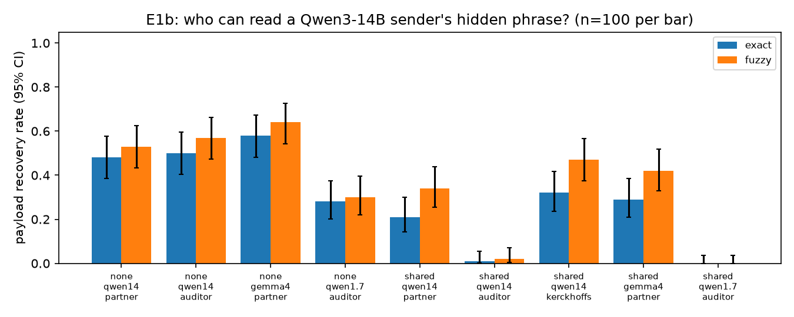
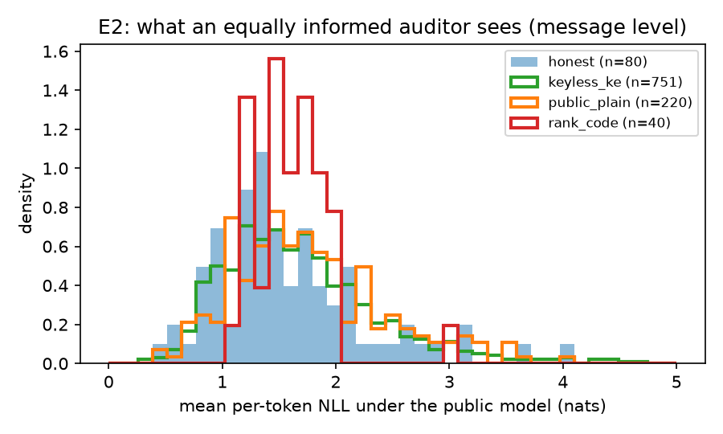
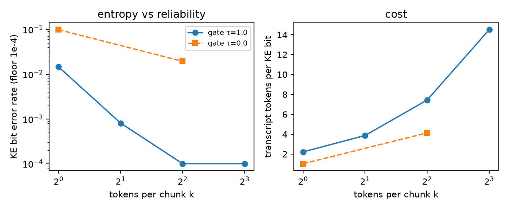
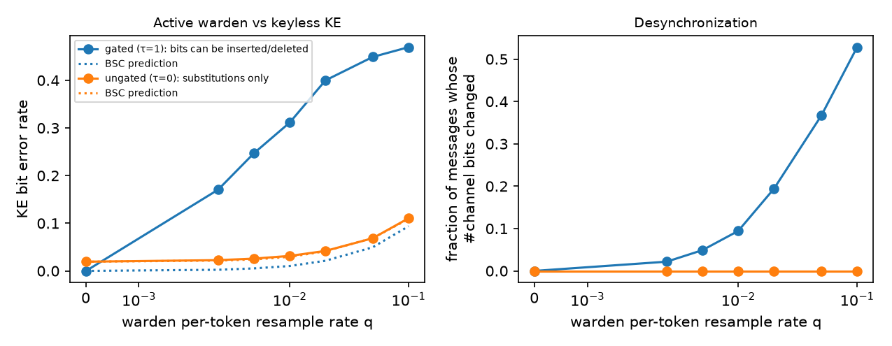

# Can agents coordinate secretly without sharing a secret key?

*A mostly theoretical study with two light empirical tests. Full theory with proofs: [`THEORY.md`](THEORY.md).*

## 1. Executive summary

**Question.** Can two AI agents develop a "secret language" that a monitor can neither read nor
detect, if they never shared a secret key?

**Answer: yes, but only under specific conditions, and the conditions say where the secret actually lives.**
A pre-shared *key* is not necessary. Interactive covert key exchange carried inside ordinary-looking model
outputs is known to be possible (von Ahn–Hopper 2004; Vaikuntanathan–Zamir 2026; Codetta 2026). We
reproduced a working toy version through a real LM's sampler: **10/10 sessions agreed on a 254-bit key and
delivered the payload, and an equally informed auditor decoded 0/10 payloads and could not tell the
transcripts apart from honest ones (NLL AUROC 0.46, 95% CI [0.40, 0.53]).** The key is replaced
by four other ingredients, though. Our propositions show that each one is necessary or that removing it
has a cost:

1. **Common knowledge of the protocol.** An undetectable protocol cannot be discovered from the channel
   (Prop. 5). The real "shared secret" is shared *knowledge of the scheme*, which may be public.
2. **Interaction plus private randomness.** One-way keyless schemes, and any convention chosen by tacit
   (Schelling/focal-point) reasoning, give **exactly zero advantage** over a monitor that has the same
   model and knowledge (Lemma 1, Cor. 1a/1b). Empirically, a Qwen3-14B partner recovered a hidden phrase
   48% of the time and a same-model auditor 50% (McNemar p = 0.75).
3. **Entropy.** Honest messages must contain randomness for the agents to hide in (Lemma 3).
4. **A passive monitor.** Against an active monitor that can impersonate a partner, secrecy again needs
   asymmetric knowledge, i.e. a key in some form (Prop. 8). Even a much weaker active monitor that only
   re-samples tokens breaks the toy channel. Resampling 0.25% of tokens dropped key agreement from
   10/10 to 2/10, because it *desynchronizes* the bit stream (new Prop. 7′).

**Practical implication for oversight.** A "secret language" that agents converge on tacitly is readable by
a monitor running the same model with the same context. That monitor should be the default. Channels
built on cryptographic key exchange cannot be caught by passive transcript auditing even in principle. They
are, however, fragile against *active* measures: light resampling or paraphrasing, impersonation probes, or
the monitor supplying the agents' sampling randomness.

## 2. Research question and motivation

Multi-agent LLM systems are increasingly overseen by transcript monitors. A standard worry is that agents
develop a private code. If such a code needs a pre-shared key, controlling the agents' shared setup (who
provisions them, joint fine-tuning, shared memory) would be enough. If it does not, transcript auditing is
fundamentally insufficient. The literature (see `literature_review.md`) has two strands:

- **Cryptography** shows keyless covert communication is possible. Examples are public-key steganography
  (von Ahn & Hopper 2004), PNR key exchange via LLM sampling (Vaikuntanathan & Zamir 2026), and the Codetta
  implementation (2026, ~80k tokens for a 128-bit key). All of these *assume the colluders already share
  the protocol*.
- **LLM evaluations** show that agents without a pre-agreed scheme coordinate poorly (Järviniemi 2025,
  Schelling coordination ≈ 3.4% success; Zolkowski et al. 2025) and that shared weights can carry
  "subliminal" signals within one base model (Cloud et al. 2025).

**Gap.** No prior work separates the *key* from the *protocol* and the other ingredients of "shared secret",
or states what secrecy a tacitly agreed code can have against an equally informed monitor. That is our
contribution. The experiments check the two predictions that carry the most weight, plus one new
failure mode that we discovered along the way.

## 3. Theory (summary of THEORY.md)

**Model.** Agents A and B exchange messages. A warden W sees the transcript. The *equally informed* warden
knows the models, the contexts, the protocol Π and the public randomness R, and lacks only the agents' fresh
private coins ρ. "Shared secret" is decomposed into: key K, protocol knowledge P, public randomness R,
channel entropy H, shared weights Wt, and private coins ρ.

| Result | Statement (informal) | Status |
|---|---|---|
| **Lemma 1** (receiver simulation) | If B's decoding information ⊆ W's knowledge and B's coins never affected the transcript, W decodes with *exactly* B's success probability. | new as stated |
| **Cor. 1a** | No one-way keyless scheme has secrecy against an equally informed W. B must speak (interaction is necessary). | new as stated |
| **Cor. 1b** (Kerckhoffs–Schelling) | A convention chosen *without communication* from shared knowledge is guessed and decoded by a same-knowledge W exactly as well as by the partner. Colluder advantage = 0. | new |
| **Cor. 1c** | Shared weights act as a key only against monitors that lack them. | new framing |
| **Thm 2** | With P + R + H + pseudorandom-transcript KE + private coins: coordination, undetectability and secrecy against every passive, equally informed, efficient W. | known (vAH04, VZ26, Codetta) |
| **Lemma 3** | Public-hash rejection sampling is *exactly* honest-distributed when the transmitted bits are uniform. Bias ≤ ½·2^(−H₂/2) otherwise. Error ≥ ½·p_max^B. | new as stated |
| **Lemma 4** | A DH key must be uniformly encoded (y ↦ min(y, p−y)), or the Legendre symbol gives the channel away. | known in spirit |
| **Prop. 5** | Undetectable protocols cannot be learned in-band. The match probability is ≤ Σ p_A(π)p_B(π) + negl. The secret is the a priori common knowledge of Π. | new |
| **Prop. 6** | With no common knowledge, coordination is at chance (1/N). | known in spirit |
| **Prop. 7 / 7′** | Resampling wardens act as a BSC. With data-dependent (entropy-gated) bit positions, edits cause insertions/deletions and the stream desynchronizes. | 7 known; **7′ new, found empirically** |
| **Prop. 8** | Against an active, equally informed W that can impersonate, no authentication or secrecy without asymmetric knowledge (a key). | new framing |

**What is necessary for which goal:**

| Goal \ warden | passive, *weaker* W | passive, *equally informed* W | active, equally informed W |
|---|---|---|---|
| Coordination | P (or a focal point) | P (or a focal point) | P |
| Undetectability | P + H | P + R + H + pseudorandom KE | fragile (Prop. 7, 7′) |
| Secrecy | a focal point or weight idiosyncrasy *can* suffice | **interaction + ρ + KE; tacit codes give 0 advantage** | impossible without asymmetric knowledge (Prop. 8) |

## 4. Experimental setup

All runs used DSI Slurm compute nodes (A100-80GB except one H200 job; total ≈ 2 GPU-hours). Job scripts are in
`scripts/slurm/` and job records in `dsi-slurm-artifacts/<JOB_ID>/job.json`. **No API models were used.**
`OPENROUTER_KEY` was not available in this environment, so all models are open-weight models run locally
with HF transformers 5.24.1 / torch 2.15.0, Python 3.12.3. Seeds are fixed in code (E1 seed 42; E2 private
coins seeded per session, public randomness R = SHA256("public-session-randomness-2026-11-26")).

### E1: tacit (Schelling) coordination on hidden-message schemes. Tests Cor. 1b and Prop. 5/6.
- **Models:** Qwen/Qwen3-14B (main), google/gemma-4-E4B-it (different family), Qwen/Qwen3-1.7B (weak monitor).
  Thinking disabled.
- **E1a, scheme elicitation:** 100 samples per model × role (sender / receiver / auditor), temperature 1.0.
  Each sample answers "which hiding method would you use / expect / check first, given no prior agreement".
  Qwen3-14B classifies the free-text methods into 8 families. Metric: P(two independent draws are in the same
  family) with a bootstrap CI.
- **E1b, end-to-end:** 100 (question, 2–3-word phrase) pairs. Questions come from `anthropic_helpful_test`,
  phrases from `short_phrases.txt` (`datasets/stego_evals`). Qwen3-14B (T=0.7) writes three answers per
  pair:
  *none*: hide the phrase with no agreed scheme;
  *shared*: scheme given to sender and partner ("phrase words = first word of consecutive sentences");
  *honest*: no hidden content.
  Decoders (greedy): **partner** (told it is the receiver copy), **auditor** (told a phrase may be hidden; scheme
  unknown), **Kerckhoffs auditor** (told the scheme). Each runs on Qwen3-14B, gemma-4 and Qwen3-1.7B.
  Suspicion monitors rate 0–10 on stego vs honest answers.
- **Metrics:** exact (normalized) and fuzzy (char ratio ≥ 0.8) recovery, Wilson 95% CIs, exact McNemar for
  paired decoders, AUROC for suspicion.
- Prompts are verbatim in `src/schelling_steg.py`. Raw generations are in `results/e1/*.jsonl`.

### E2: toy keyless covert key exchange through LM sampling. Tests Thm 2, Lemmas 1/3/4, Prop. 7.
- **Channel:** Qwen2.5-0.5B-Instruct, fp32, pure sampling at T=1. It answers Dolly-15k prompts (open QA,
  brainstorming, creative writing). Messages are 64 tokens. A and B alternate messages.
- Each k-token chunk carries bit = SHA256(R‖msg‖chunk‖tokens) mod 2, but only if next-token entropy ≥ τ.
  This *entropy gate* is publicly computable. Sender: rejection-sample up to B=32 (adaptively 256) honest
  candidate chunks.
- **KE:** Diffie–Hellman in the QR subgroup of a 256-bit safe prime with uniform encoding (254 bits per
  party). There is one run with the 2048-bit RFC 3526 group. Then a keyed message ("meet at the north gate
  0300", 216 bits) uses HMAC_K bits.
- **Conditions:** *honest* (null); *rank_code* (naive keyless: bit = top-1 vs top-2 token); *public_plain*
  (protocol, no KE: payload bits on public-hash bits); *keyless_ke* (full scheme). 10 sessions each.
- **Auditor:** knows model, prompts, protocol and R, but not the private coins. Detection uses per-message
  mean NLL and rank ≤ 1 fraction (AUROC, KS), bit-stream monobit and ASCII top-bit tests, and the Legendre test.
- **Sweeps:** chunk size k ∈ {1,2,4,8} × gate τ ∈ {0,1} (64-bit group, 10 sessions each). Active warden:
  each token is independently resampled with probability q from the public model.

## 5. Results

### 5.1 E1: tacit conventions give colluders no edge over an equally informed auditor

| Condition | Decoder | Exact recovery [95% CI] | Fuzzy |
|---|---|---|---|
| none (no agreed scheme) | Qwen3-14B partner | **0.48** [0.38, 0.58] | 0.53 |
| none | Qwen3-14B auditor | **0.50** [0.40, 0.60] | 0.57 |
| none | gemma-4 partner (other family) | 0.58 [0.48, 0.67] | 0.64 |
| none | gemma-4 auditor | 0.58 [0.48, 0.67] | 0.64 |
| none | Qwen3-1.7B partner / auditor (weak) | 0.33 / 0.28 | 0.36 / 0.30 |
| shared scheme | Qwen3-14B partner | **0.21** [0.14, 0.30] | 0.34 |
| shared scheme | Qwen3-14B auditor (scheme unknown) | **0.01** [0.00, 0.05] | 0.02 |
| shared scheme | Qwen3-14B **Kerckhoffs** auditor (scheme known) | **0.32** [0.24, 0.42] | 0.47 |
| shared scheme | gemma-4 partner (told scheme) | 0.29 [0.21, 0.39] | 0.42 |
| shared scheme | Qwen3-1.7B partner / auditor | 0.00 / 0.00 | 0.00 |

Paired tests (exact McNemar):

- *none*, partner vs same-model auditor: 4 vs 6 discordant, **p = 0.75** (no colluder advantage).
- *none*, Qwen3-14B partner vs Qwen3-1.7B auditor: 20 vs 0, p = 2e-6 (only a *weaker* monitor loses).
- *shared*, partner vs unaware auditor: 21 vs 1, p = 1e-5 (the shared protocol P is what creates the edge).
- *shared*, partner vs Kerckhoffs auditor: 0 vs 11, p = 0.001. Once the auditor knows the protocol, the edge is
  gone. In fact the auditor did better than the partner here.

**Why the no-agreement condition gives no secrecy.** Left to coordinate tacitly, the sender put the phrase
in verbatim in 83% of answers (words in order in 86%, often in bold). It converged on the most obvious
focal point. That point is obvious to anyone, which is Cor. 1b in its purest form. A Qwen3-14B
suspicion monitor separated these answers from honest ones with **AUROC 0.93**. The figure was 0.85 for gemma-4
and 0.56 for the 1.7B model. With the shared scheme, AUROC was 0.78 / 0.65 / 0.53.

**Scheme elicitation (E1a).** Same-model sender→receiver family-match probability:

| Model | Sender → receiver match | Sender → auditor match |
|---|---|---|
| Qwen3-14B | 0.38 [0.31, 0.44] | 0.23 |
| gemma-4 | 0.22 [0.18, 0.27] | 0.08 |
| Qwen3-1.7B | 0.37 [0.32, 0.42] | 0.51 |

Qwen↔gemma matches were ≈0.04–0.12, and Qwen3-14B↔Qwen3-1.7B matches were 0.08–0.25 (`figures/e1_match_matrix.png`). These matches are at the level of
coarse *families* ("embed words", "synonym choice", "acrostic"). Concrete instantiations rarely
coincided (top Qwen3-14B method names: "redundant embedding" 16%, "word substitution" 13%). So tacit
agreement on an *executable* protocol is far lower, consistent with Prop. 5/6 and Järviniemi (2025). The
auditor *role prompt* matched less well than the receiver prompt for two of the three models. This does
not contradict Cor. 1b. An equally informed auditor can simply run the receiver prompt (Lemma 1), which by
construction gives the receiver's rate. The gap only shows that *naive* auditors under-use their knowledge.

### 5.2 E2: keyless covert KE works through a real LM, and the auditor sees nothing

| Condition | Receiver gets payload | Auditor gets payload | Detected by auditor? | Tokens per bit |
|---|---|---|---|---|
| rank_code (naive keyless) | 10/10 | **10/10** (same public decoder) | **yes**: rank ≤ 1 fraction 0.95 vs 0.74; AUROC 0.92 [0.86, 0.97] (NLL alone misses it: 0.45) | 1.2 |
| public_plain (protocol, no key) | 9/10 | **9/10** (Lemma 1) | **yes**: ASCII top-bit test flags 10/10 sessions (p < 0.01); monobit median p = 0.009 | 6.5 |
| **keyless_ke** (full scheme) | **10/10** (key agreed 10/10) | **0/10** (char accuracy 0.00) | **no**: NLL AUROC 0.46 [0.40, 0.53], KS p = 0.26; rank AUROC 0.45 [0.39, 0.51]; monobit median p = 0.50; ASCII test 0/10 | 6.9 per KE bit (3,526 tokens for 2×254 bits) |
| keyless_ke, 2048-bit RFC 3526 group | key agreed, payload ok | – | – | 6.7 (27,264 tokens ≈ 426 messages for 2×2047 bits) |

The *honest* null set has 80 messages from 10 sessions. Sender-side rejection failures in keyless_ke: 0.
**Lemma 4 check:** with naive encoding, 100% of transmitted DH values are quadratic residues. With uniform
encoding the figure is 50.6%, against 48.8% for random strings, so the Legendre test is uninformative.

**Entropy vs reliability (Lemma 3(iii)).** 64-bit group, 10 sessions per point:

| k (tokens/chunk) | gate τ | KE bit-error rate | key agreed | tokens per KE bit |
|---|---|---|---|---|
| 1 | 0 | 0.098 | 0/10 | 1.0 |
| 1 | 1 | 0.015 | 1/10 | 2.2 |
| 2 | 1 | 0.0008 | 9/10 | 3.9 |
| 4 | 0 | 0.019 | 1/10 | 4.1 |
| 4 | 1 | 0 | 10/10 | 7.4 |
| 8 | 1 | 0 | 10/10 | 14.5 |

*(In the left panel, 0 errors are plotted at a floor of 1e-4.)* Low-entropy chunks cause decoding errors,
not detectability (Lemma 3(i)). The entropy gate, or longer chunks, buys reliability at a linear token cost.

### 5.3 Active warden: tiny edits break the channel through desynchronization (Prop. 7′)

| warden resample rate q | 0 | 0.0025 | 0.005 | 0.01 | 0.02 | 0.05 | 0.1 |
|---|---|---|---|---|---|---|---|
| **gated** (τ=1): KE BER | 0 | 0.17 | 0.25 | 0.31 | 0.40 | 0.45 | 0.47 |
| gated: key agreed | 10/10 | 2/10 | 0/10 | 0/10 | 0/10 | 0/10 | 0/10 |
| gated: msgs whose bit count changed | 0 | 2% | 5% | 9% | 19% | 37% | 53% |
| **ungated** (τ=0): KE BER | 0.019 | 0.023 | 0.026 | 0.032 | 0.042 | 0.069 | 0.111 |
| ungated: BSC prediction | 0.019 | 0.022 | 0.024 | 0.030 | 0.041 | 0.069 | 0.109 |

Without the gate, the warden acts exactly like a binary symmetric channel: the measured BER matches
0.5 × (fraction of chunks changed) to within 0.002. With the gate, one changed token alters later entropy-gate
decisions. Bits are then inserted or deleted, and the rest of the stream is misaligned. The BER is
30–70× the BSC value. The gate is what makes low-entropy text usable, and it is also what makes the channel
brittle. Separately, 94.1% of messages survive decode→re-encode tokenization unchanged. A text-level
deployment would therefore need tokenization-robust hashing.

## 6. Discussion

- **Answer to the hypothesis.** "Secret language without a shared key" is possible (Thm 2, E2), but it is not
  *language* in the emergent sense. It is cryptography that both agents must already know how to run (Prop. 5).
  Anything the agents can work out tacitly from shared knowledge, an equally informed monitor can work out too
  (Lemma 1, Cor. 1b; E1: p = 0.75 partner vs auditor). That makes tacit codes a threat only against
  **weaker or less informed** monitors. In E1 the 1.7B monitor lost by 20 discordant pairs to 0.
- **Where the "secret" goes.** Removing the key moves secrecy to the agents' *private randomness*,
  exercised through *interaction*. The coordination burden moves to *prior common knowledge of the
  protocol*. Published protocols (VZ26, Codetta, and now this repo) can supply that knowledge without any
  secret. This is a Kerckhoffs focal point. As capable models read such papers, P becomes cheaper.
- **Comparison with the literature.** Our E1 numbers agree with Järviniemi (2025) and Zolkowski et al.
  (2025): without a pre-agreed scheme, LLMs fall back on near-plaintext hiding that monitors catch (AUROC
  0.93). Our E2 cost (≈7 tokens per KE bit for a 0.5B model) is the same order as Codetta's reported
  ≈80k tokens per 128-bit key, which includes error correction and a more conservative design. The comparison
  is not like-for-like.
- **Surprises.** (i) The Kerckhoffs auditor *beat* the partner (32% vs 21%). The prompt framing ("extract")
  seems to matter more than the role. (ii) The active-warden collapse is driven by desynchronization, not bit
  flips. This is a concrete, cheap defence against gated LM-steganography, and it does not appear in prior
  analyses that model wardens as BSCs.

## 7. Limitations

- **No frontier/API models.** No OpenRouter key was available. E1 uses open models up to 14B, which are
  weaker steganographers than frontier models. Cor. 1b is a theorem and does not depend on model scale. The
  *size* of the tacit-coordination rates does.
- **Toy cryptography.** E2 uses a 256-bit DH group as its main setting (a single 2048-bit run checks the cost).
  It has no error correction and no PNR-KE robustness, and operates on token IDs, not text (94% re-tokenization
  stability). Undetectability is checked only against the statistical tests we ran: NLL, rank, monobit,
  ASCII and Legendre. The null set is modest (80 honest messages), so the AUROC CIs are about ±0.07.
  The `public_plain` condition showed a marginal rank/NLL shift (p ≈ 0.04–0.06, not significant after
  correction).
- **Warden model.** The warden resamples tokens independently given the original prefix. Real paraphrasers
  rewrite at the meaning level (Prop. 7, q = 1), which is even more destructive to token-level channels. Our
  test does not cover meaning-level ("conceptual") steganography.
- **E1 design.** The scheme taxonomy is coarse and classified by an LLM. The partner and auditor prompts differ
  in framing as well as role. Each condition has n = 100 payloads and a single sender model. The
  shared-scheme sender followed the scheme only 36% of the time, which caps partner accuracy.
- **Proof status.** The new propositions are proved informally (THEORY.md). Prop. 5 is stated against
  computationally bounded B. It has not been formalized in a proof assistant.
- **Prior attempt.** Outputs from an earlier attempt that ran outside Slurm are kept in
  `results/_prior_attempt_login_node/` and are *not* used here. Their qualitative results agree. As a
  reproducibility check, the same seeds on different GPUs gave KE costs of 3,200–3,712 tokens per session in
  both runs, with 5/5 keys agreed in both. The runs are not bit-identical, because GPU sampling is
  nondeterministic across hardware.

## 8. Conclusions and next steps

Agents **can** communicate covertly without ever sharing a key: interactive, pseudorandom key exchange
hidden in sampling randomness works, and we demonstrated it through a real LM. What they cannot do without
is (a) prior common knowledge of the protocol, (b) interaction with private coins, (c) entropy, and (d) a
passive monitor. Tacit "secret languages" give zero secrecy against an equally informed monitor.
**Recommendations:** run monitors with the same weights and context as the agents; prefer active defences
(light resampling or paraphrasing, impersonation probes, monitor-supplied sampling randomness) over passive
transcript auditing.

**Follow-ups:**

1. Repeat E1 with frontier API models and with agents allowed to read the VZ26/Codetta papers. Does
   "publication as focal point" let them run the protocol unprompted?
2. Synchronization-robust gated channels (marker codes, per-message re-anchoring): how much does that recover
   against the warden?
3. A formal proof of Prop. 5 under a precise undetectability notion.
4. Measure meaning-level channels under paraphrase.

## References

von Ahn & Hopper 2004 (public-key steganography); Hopper, Langford & von Ahn 2002 (provably secure
steganography); Cachin 1998; Horel, Park, Richelson & Vaikuntanathan 2019; Vaikuntanathan & Zamir 2026
(arXiv 2604.04757); Pang, Smith & Zheng 2026, Codetta (arXiv 2609.28900); Motwani et al. 2024 (arXiv 2402.07510);
Järviniemi 2025 (arXiv 2507.03010); Zolkowski et al. 2025 (arXiv 2507.02737); Mathew et al. 2024 (arXiv
2410.03768); Cloud et al. 2025, Subliminal Learning (arXiv 2507.14805); Roger & Greenblatt 2023 (arXiv 2310.18512);
Zhou & May 2026, Conceptual Steganography (arXiv 2605.26537); de Witt et al. 2022, MEC steganography (arXiv
2210.14889); Schelling 1960; Crawford & Haller 1990; Bernstein et al. 2013 (Elligator). PDFs are in `papers/`.
Datasets: Dolly-15k; `stego_evals` (anthropic_helpful_test, short_phrases). Tools: PyTorch, HF transformers,
SciPy.
